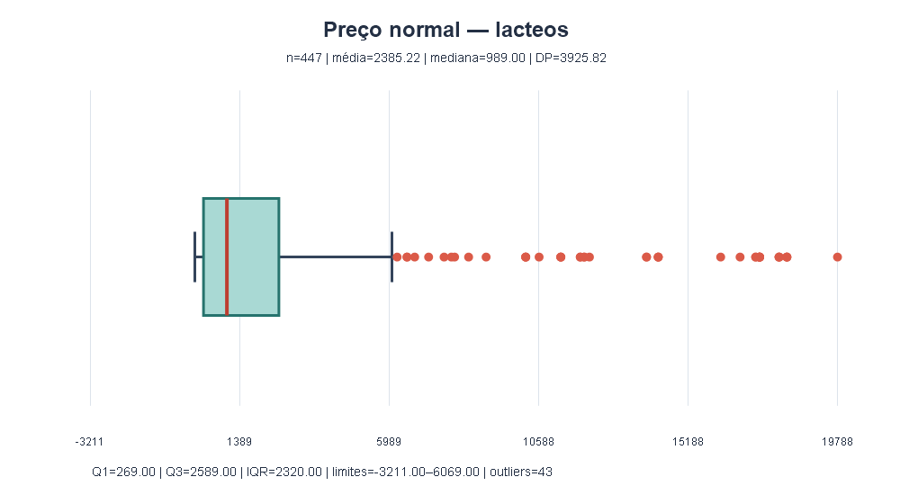
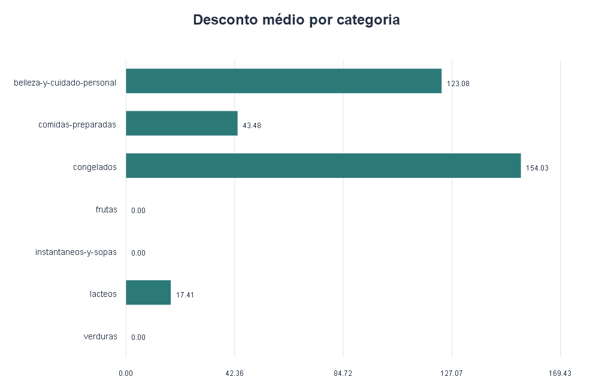
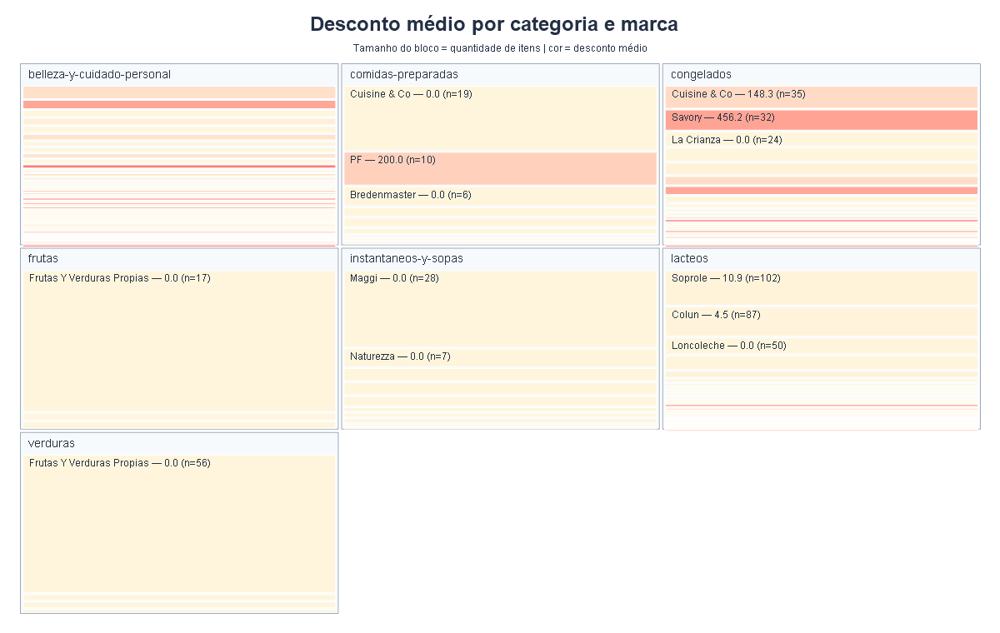

# Análise de vendas do supermercado

Exercício de estatística descritiva feito com Python e a base de vendas fornecida no curso.

## Para executar

Instale as bibliotecas necessárias:

```bash
pip install pandas matplotlib seaborn plotly
```

Depois, abra esta pasta no terminal e execute:

```bash
python analise_estatistica_supermercado.py
```

O programa mostra as médias e medianas no terminal e cria os gráficos nesta pasta.

## Gráficos

### Boxplot do preço normal em lacteos



### Desconto médio por categoria



### Mapa por categoria e marca

O mapa interativo pode ser aberto [neste arquivo](mapa_categoria_marca.html). A imagem abaixo é uma prévia para a atividade.



## Resultado principal

`lacteos` tem o maior desvio padrão. A média do preço nessa categoria é maior que a mediana, o que mostra que alguns preços altos puxam a média para cima. Pelo critério de 1,5 vezes o intervalo interquartil, há 43 outliers acima do limite superior.

O mapa interativo é um treemap: cada bloco mostra uma marca dentro de uma categoria. O tamanho representa a quantidade de itens e a cor representa o desconto médio.
